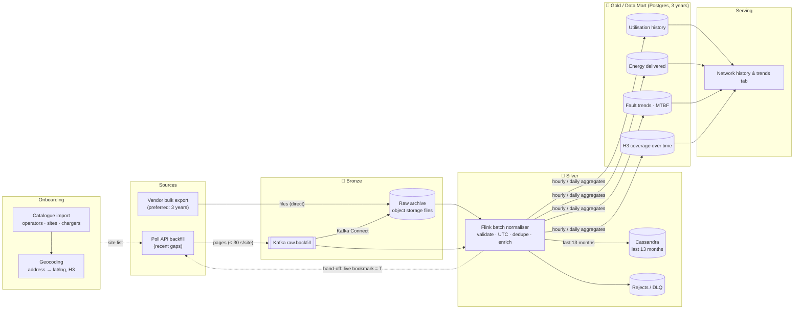
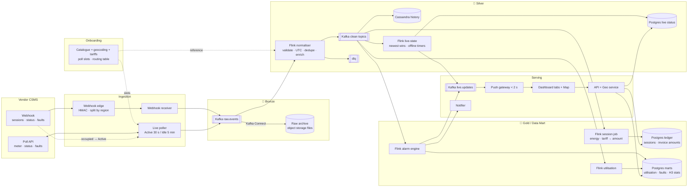
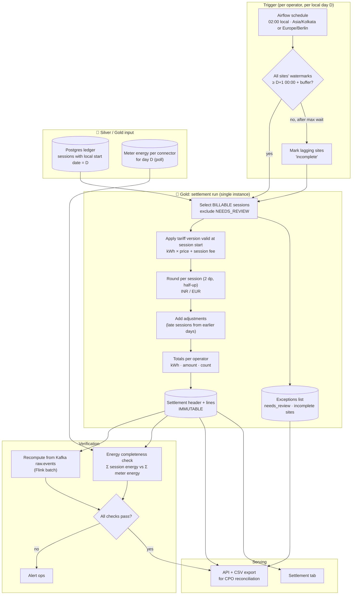

# GridWatch — End-to-End Data Flow

## 1. Overview

**What GridWatch is**
- A multi-tenant platform for monitoring and settling EV charging networks
- Hierarchy: **Operator → Site → Charger → Connector**

**What we have**
- **One data source: the vendor CSMS**
  - **Poll API:** each site can be polled at most once every 30 s; responses are paginated; it returns 429 and 500 errors and occasionally malformed data
  - **Webhook:** delivers events at least once, so expect duplicates and out-of-order events; it batches events for up to 60 s
- **Data quirks**
  - Energy is a **cumulative Wh counter** that can reset
  - Sites have an **address only**, no latitude/longitude
  - Timestamps are in the charger's **local time with an offset**
- **Scale**
  - Pilot: 50 sites / 220 chargers
  - Production: **12k sites / 50k chargers** across India and Germany, about **5k events/s**

**What we want to achieve**
1. **Ingest:** bring poll and webhook data into one clean schema
2. **Dashboard:** live status, active sessions, faults, utilisation
3. **Live map:** status colours, nearest available charger, density, coverage gaps
4. **Settlement:** energy × per-CPO tariff + session fee, in INR or EUR, with a daily total
5. **Analytics & alerts:** utilisation, fault trends, offline detection, threshold alerts; demand forecasting as an approach only

**Success criteria**
- Freshness targets:
  - Status < 5 s
  - Faults < 5 s
  - Session power/energy < 10 s
  - Dashboard tiles < 2 s
  - Map < 10 s
- Accuracy:
  - No data loss
  - No double billing
  - No negative bills
- Compliance: personal and billing data stays in its own country

**Key constraint**
- The vendor's 30–60 s delays cap how fresh data can be, so we measure latency from **received by GridWatch → shown on screen**

---

## 2. Data Sources

**Assumption:** vendor-side failover is handled by the vendor; webhook delivery and poll availability are treated as reliable.

### 2.1 Webhook (push): primary source for **changes**

**What we get**

| Event | Key fields |
|---|---|
| `session.start` | `session_id`, `charger_id`, `connector_id`, `start_meter_wh`, `ts` |
| `session.stop` | `session_id`, `charger_id`, `connector_id`, `start_meter_wh`, `stop_meter_wh`, `ts` |
| `status` | `charger_id`, `connector_id`, `status`, `ts` |
| `fault` | `charger_id`, `connector_id`, `code`, `severity`, `ts` |

**How it helps**
- **Only source of sessions**, which billing and settlement depend on
  - Sessions are available only **from the date the webhook is registered**; no historical sessions can be recovered
- **Primary source of status changes and faults**, which drive the dashboard, map and alarms
- **Triggers active polling**: a `session.start` or an occupied status switches that site's poller to **Active** mode (section 2.2)
- **Pushed to us**: no polling and no rate limit
- `session.stop` carries both meter readings, so session energy is known **as soon as it arrives**, even if `session.start` hasn't arrived yet

**What to expect** (from the vendor contract and stubs)
- **Batched**: events can be held for up to **60 s**
- **Duplicates**: a redelivered batch arrives with a new `delivery_id`
- **Out-of-order** events
- Each request is **HMAC-signed** (`X-CSMS-Signature`)
- We must reply `2xx` **quickly**; a slow reply makes the vendor resend the whole batch

### 2.2 Poll API (pull): primary source for **power and energy**

**What we get**

| Event | Key fields |
|---|---|
| `meter_value` | `charger_id`, `connector_id`, `energy_register_wh`, `power_w`, `ts` |
| `status` | `charger_id`, `connector_id`, `status`, `ts` |
| `fault` | `charger_id`, `connector_id`, `code`, `severity`, `ts` |

**How it helps**
- **Only source of power and energy**: live kW, energy so far in a session, utilisation, meter-reset detection
- Readings are recorded about **every 10 s**, so each 30 s poll returns about 3 readings per connector and we keep the full 10 s history
- **Status and faults come back here too.** Whichever copy arrives first updates the dashboard, and the duplicate is dropped
- **History**: we can fetch from any `since`, which lets a separate backfill process load history

**How we use it**

| Process | Mode | Frequency | Purpose |
|---|---|---|---|
| **Live poller** | **Active** | Every **30 s** | Live power and energy while any connector at the site is occupied. The first poll uses `since = session start`, so the readings that arrived while the webhook was delayed are still fetched |
| **Live poller** | **Idle** | Every **5 min** | Heartbeat that returns current status: offline detection, plus a safety net for status or fault webhooks we missed |
| **Backfill service** | One-time per site (recent gaps) | Within the 30 s per-site limit | Loads recent history (status, meter readings, faults) into `raw.backfill` → Flink batch normaliser → Cassandra and Postgres marts. These events go to history only and never raise alarms or push live updates. Multi-year history comes from a vendor bulk export (section 4.1) |

- **Active → Idle**: when the last occupied connector frees up, do one final poll, then switch to Idle
- **Backfill → Live**: backfill drains up to `server_time` T, then the live bookmark is set to T, so there is no gap and no overlap
- **Load**: about **130 polls/s** instead of 400 polls/s (12k sites, assuming about 25% are active at any time)

**What to expect** (from the vendor contract and stubs)
- **One site per call**, at most **once every 30 s** per site, otherwise `429`
- **Paginated**: follow `next_cursor` until it's absent
- Occasional `500` errors and **malformed events**
- `since` is inclusive, so events at the boundary come back twice
- **No session events**

### 2.3 Reference data

| Source | What we get | Used for | Notes |
|---|---|---|---|
| **Site & charger catalogue** (vendor catalogue / CPO import) | Operators, sites (`site_id`, address, country), chargers (`max_kw`, connectors) | Validation, enrichment, plausibility checks, utilisation | Loaded before any telemetry arrives |
| **Nominatim (OpenStreetMap)** | lat/lng per site, plus region names (state, district) | GIS map, nearest charger, density, coverage gaps | Geocode **once per site**, then cache; manual pin overrides it |
| **Region area table** (static) | km² per region | Chargers per km² by region | Small table built from public sources |
| **Tariffs** (our configuration) | Per-CPO price per kWh, session fee, currency, validity dates | Invoice amount, daily settlement | Not in the vendor feed |

**Geocoding approach**
- **Exact coordinates from the CPO** are used whenever the CPO provides them; geocoding fills in the rest
- **Self-hosted Nominatim** runs in each region, loaded with the India and Germany OpenStreetMap extracts, so there are no rate limits and no external dependency
- Each site is geocoded **once at onboarding**. It is geocoded again only if its address changes
- **Pincodes are cross-checked** against official India Post data, because Indian pincode areas in OSM come from community tagging rather than official boundaries
- **Ops tooling** lets operators correct pins by hand. A geocoded result points to the landmark (a mall or station), not the charger bay, so manual correction is sometimes needed
- "© OpenStreetMap contributors" is shown on the map

**Geocoding flow**
1. Extract the pincode (India: 6 digits, Germany: 5 digits)
2. Look up the pincode's bounding box in Nominatim and add a 2 km buffer
3. Split the address by commas and search each part **inside that box**
4. Pick a result:
   - POI, building, railway or amenity (rank ≥ 26) → **High** precision
   - Locality or suburb (rank 18–25) → **Medium** precision
   - Only roads, or nothing → **Low** precision: use the pincode centre and send the site for a manual pin
5. Store `lat`, `lng`, precision and source. A manual pin always overrides a geocoded result

**Licences**

| Item | Licence | Commercial use |
|---|---|---|
| Nominatim / OSM data | ODbL | ✅ with attribution |
| H3 | Apache 2.0 | ✅ |
| Production boundaries: OSM / geoBoundaries | ODbL / CC BY 4.0 | ✅ with attribution |
| GADM | Non-commercial only | ❌ avoid |

### 2.4 Summary

| Data | Primary source | Secondary |
|---|---|---|
| Sessions | **Webhook** (from registration date) | — |
| Status | **Webhook** | Poll (active 30 s / idle 5 min) |
| Faults | **Webhook** | Poll (active 30 s / idle 5 min) |
| Power & energy | **Poll API** (active sites, 30 s) | — |
| History (status, meter, faults) | **Vendor bulk export** (3 years) | Poll API backfill service (recent gaps) |

---

## 3. Components

Designed for production: **12,000 sites / 50,000 chargers**, India + Germany.

**Where:** 🇮🇳🇩🇪 = one per country region, each with a standby in the same country · 🌐 = global (non-personal data only)

### 3.1 Catalogue & Geo

| Component | Purpose | Where / Sizing |
|---|---|---|
| **Catalogue DB** (Postgres + PostGIS) | Operators, sites (lat/lng, H3, region, timezone), chargers, tariffs, alert rules, poll slots and bookmarks | 🇮🇳🇩🇪 Shared with the main Postgres |
| **Onboarding service** | Imports sites and chargers, assigns poll slots, starts backfill, marks sites live | 🇮🇳🇩🇪 |
| **Geocoding service** | Converts an address to lat/lng by searching within the pincode area, scores confidence, applies manual pin overrides | 🇮🇳🇩🇪 Self-hosted Nominatim with India and Germany extracts. One-off run of ~36k queries |
| **Geo service** (H3 + PostGIS) | Nearest available charger, chargers per km², coverage gaps | 🇮🇳🇩🇪 + 🌐 · 2 pods |
| **Routing table** | `charger_id → region` lookup for the webhook edge | 🌐 |

### 3.2 Ingestion

| Component | Purpose | Where / Sizing |
|---|---|---|
| **Webhook edge** | Verifies the HMAC, splits each batch by region, forwards it, stores nothing | 🌐 2 locations, active-active |
| **Webhook receiver** | Verifies the HMAC, writes the raw batch to Kafka (`acks=all`), replies `2xx` | 🇮🇳🇩🇪 3 pods (one per zone), ~100 req/s at peak |
| **Live poller** | **Active** (every 30 s) while any connector at the site is occupied; **Idle** heartbeat (every 5 min) otherwise; 300 slots per 30 s cycle | 🇮🇳🇩🇪 6 cells × 2,000 sites, each with one leased async worker and a standby. ~130–220 polls/s |
| **Backfill service** | One-time load of recent history per site: Poll API → `raw.backfill` → Cassandra and Postgres marts. Feeds history only, never alarms. Multi-year history comes from a vendor bulk export | 🇮🇳🇩🇪 Low priority, ~200 sites in parallel, stays within each site's 30 s limit |
| **Coordination store** (etcd) | Poller leases, so exactly one worker polls each cell | 🇮🇳🇩🇪 3 nodes |

### 3.3 Messaging (Apache Kafka)

| Component | Purpose | Where / Sizing |
|---|---|---|
| **Kafka (regional)** | Event backbone, keyed by `charger_id` | 🇮🇳🇩🇪 3 brokers (one per zone), RF 3, `min.insync.replicas=2`, 48 partitions per main topic, ~5k msg/s at peak |
| **Kafka (global)** | Network-wide events with no personal data | 🌐 3 brokers |
| **MirrorMaker 2** | Copies regional → in-country standby (all topics) and regional → global (allow-listed topics only) | 🇮🇳🇩🇪 → 🌐 |
| **Schema Registry** | Versioned clean internal schema | 🇮🇳🇩🇪 |
| **Kafka Connect (object storage sink)** | Writes `raw.events` and `raw.backfill` to the raw archive as gzip JSON files, partitioned by `region/date/hour` | 🇮🇳🇩🇪 2 workers |

**Topics**

| Lane | Topics | Retention |
|---|---|---|
| 🔒 Safe (lossless) | `raw.events`, `raw.backfill`, `session.clean`, `meter.clean`, `dlq` | raw: 7 days (~3.6 TB with replicas) · clean: 3 days · dlq: 30 days |
| ⚡ Fast | `status.clean`, `fault.clean`, `meter.live`, `live.updates` | 1 day |

### 3.4 Stream Processing (Apache Flink)

| Job | Purpose | Lane | Where |
|---|---|---|---|
| **Normaliser** | Validates, converts timestamps to UTC, enriches from the catalogue, checks plausibility, fingerprints, routes bad events to the DLQ | Both | 🇮🇳🇩🇪 |
| **Live-state** | Connector status (newest wins), charger rollup, live power/energy, offline timers | ⚡ | 🇮🇳🇩🇪 |
| **Session job** | One row per `session_id`, energy, reset and plausibility checks, tariff → amount, exactly-once | 🔒 | 🇮🇳🇩🇪 |
| **Alarm engine** | Threshold rules and alarm lifecycle (open → ack → resolved) | ⚡ | 🇮🇳🇩🇪 |
| **Utilisation aggregator** | Time and energy utilisation per connector, site and region → Postgres | ⚡ | 🇮🇳🇩🇪 |
| **Global aggregator** | H3 rollups for the network map | ⚡ | 🌐 |
| **Batch normaliser** | Loads history (bulk export files, `raw.backfill`): same validation as the Normaliser → Cassandra (last 13 months) and Postgres marts (3 years) | 🔒 | 🇮🇳🇩🇪 |
| **Recompute (batch mode)** | Recomputes the day's settlement from `raw.events` in Kafka (7-day retention) and compares it with the ledger. Older periods are replayed from the raw archive | 🔒 | 🇮🇳🇩🇪 |

**Cluster:** 3 TaskManagers × 4 slots per region (one per zone), parallelism 12, state < 2 GB, checkpoints every 10 s to object storage, about 10× headroom.

### 3.5 Storage

| Store | Holds | Where / Sizing |
|---|---|---|
| **Postgres + PostGIS** | Catalogue, live status (upsert, newest wins), pre-computed aggregates, **sessions / invoices / settlements / adjustments**, geo | 🇮🇳🇩🇪 Primary + synchronous standby + read replica (8–16 vCPU / 64 GB) · 🌐 small instance for global aggregates |
| **Cassandra** | Telemetry history at 10 s resolution, 13-month TTL. Bigtable-style model: `USING TIMESTAMP` and idempotent keys | 🇮🇳 ~6 nodes · 🇩🇪 ~3 nodes, RF 3 across 3 zones. ~15–20 TB in total over 13 months, ~5k writes/s at peak |
| **Raw archive** (object storage) | Plain gzip JSON files exactly as received (webhook batches, poll pages, bulk export files). Used for audit, disputes and replay; not queried by the product | 🇮🇳🇩🇪 ~30 GB/day (~11 TB/year, ~33 TB over 3 years), moved to cold tiers by lifecycle rules |

**Retention:** Postgres marts keep **3 years** of hourly and daily aggregates (trends tab). Cassandra keeps **13 months** at 10 s resolution. The raw archive keeps everything.

### 3.6 Batch (Apache Airflow)

| Job | Schedule | Where / Sizing |
|---|---|---|
| **Daily settlement** | Per operator, after the site's local day closes. Waits for every site's watermark to pass midnight, then runs once | 🇮🇳🇩🇪 ~600k sessions/day, finishes in minutes |
| **Recompute check** | After settlement | 🇮🇳🇩🇪 Flink batch job |
| **Coverage / density stats** | Hourly | 🌐 |
| **Forecasting** (approach only) | Weekly | 🌐 |
| **Housekeeping** | Daily (mart partition retention, archive lifecycle checks) | 🇮🇳🇩🇪 |

### 3.7 Serving

| Component | Purpose | Where / Sizing |
|---|---|---|
| **API service** | Dashboard, map, settlement and alert APIs, all filtered by `operator_id`. Includes an admin endpoint to inspect and replay the DLQ | 🇮🇳🇩🇪 3 pods |
| **Push gateway** (WebSocket/SSE) | Delivers `live.updates` to the browser in < 2 s, filtered per tenant and batched every 0.5–1 s | 🇮🇳🇩🇪 3 pods, ~1–2k concurrent users |
| **Web app** | Dashboard + MapLibre GL map, showing "© OpenStreetMap contributors" | 🇮🇳🇩🇪 |
| **Notifier** | Sends alerts by email, SMS or webhook | 🇮🇳🇩🇪 |
| **Identity provider** (OIDC) | Operator login and tenant roles | 🇮🇳🇩🇪 |

### 3.8 Observability & Platform

| Component | Purpose | Where / Sizing |
|---|---|---|
| **Prometheus + Grafana** | Contract KPIs (P99.9 from receipt to screen), vendor delay, 429/500 rates, DLQ size, **per-stage event counters with mismatch alerts** (Chaperone-style), alerting | 🇮🇳🇩🇪 Labels per cell and stage only, never per site |
| **Central logging** (Loki or cloud logging) | Structured JSON logs | 🇮🇳🇩🇪 |
| **Secret manager** (cloud-managed) | HMAC secret, vendor credentials | 🇮🇳🇩🇪 |
| **Kubernetes** (managed EKS / GKE / AKS) | Runtime across 3 zones | 🇮🇳🇩🇪 + 🌐 |

### 3.9 Per-region footprint

| Component | 🇮🇳 India (~9k sites) | 🇩🇪 Germany (~3k sites) |
|---|---|---|
| Poller | 5 cells + standbys | 2 cells + standbys |
| Kafka | 3 brokers | 3 brokers |
| Flink | 3 TaskManagers | 3 TaskManagers |
| Postgres | Primary + standby + read replica | Primary + standby + read replica |
| Cassandra | ~6 nodes | ~3 nodes |
| Raw archive (object storage) | ~8 TB/year | ~3 TB/year |
| Services (receiver, API, push, geo) | 2–3 pods each | 2–3 pods each |
| In-country standby | Second Indian cloud region | Second EU region |

**🌐 Global:** Kafka (3 brokers), Flink global aggregator, a small Postgres, and 2 webhook edge locations.

**Sizing assumptions:** ~100k connectors; 25% active on average, 50% at peak; meter readings every ~10 s per active connector; ~6 sessions per connector per day; India ~9k / Germany ~3k sites.

### 3.10 Design Decisions

| Decision | Reason |
|---|---|
| **Flink for stream processing** | Keyed state, event time, timers and exactly-once map directly onto our requirements |
| **Postgres for money and state, Cassandra for history** | Keeps the exact, transactional workload apart from the high-volume write workload, so neither slows the other |
| **No Pinot in v1** | Flink pre-computes the dashboard queries. Pinot can be added later on the existing Kafka topics if customer-facing or ad-hoc analytics becomes a requirement |
| **No Trino in v1** | Recompute runs on Flink in batch mode. Trino can be added later for ad-hoc analyst SQL |
| **No Hudi / lakehouse in v1** | The trends tab needs only hourly and daily values, which Postgres marts hold for 3 years; detailed history is in Cassandra for 13 months. The raw archive is plain files on object storage, so there is no table format or compaction to run. Cost: no SQL over raw history older than 7 days, and old replays read files more slowly. A lakehouse can be added later on the same files if ad-hoc analytics or forecasting needs it |
| **Airflow for batch** | Settlement needs a scheduler that is auditable, runs each job once and handles timezones |
| **Audit via Prometheus counters** | Gives the same guarantee as Chaperone without another service to run |
| **Managed Kubernetes and secrets** | Less to operate ourselves |
| **No distributed tracing in v1** | Latency is already measured with event timestamps |

---

## 4. Data Flows

All three flows use the same layers:

| Layer | Meaning | Components |
|---|---|---|
| **Onboarding** | Records what exists before any data arrives | Catalogue import, geocoding, tariffs, poll slots, routing table |
| **🥉 Bronze** | Raw data, **exactly as received** | Kafka `raw.events` / `raw.backfill`, raw archive files (object storage) |
| **🥈 Silver** | Validated, converted to UTC, deduplicated, enriched | Flink normaliser → clean topics, Cassandra history (13 months), Postgres live status |
| **🥇 Gold / Data Mart** | Ready for business use | Sessions + invoice amounts, settlements, utilisation, fault trends, H3 coverage (Postgres ledger and marts, 3 years) |
| **Serving** | What users see and use | API, push gateway, dashboard tabs, map, settlement export |

### 4.1 Historical Ingestion (last 3 years)

**Key points**
- **Source:** the vendor **bulk export** is preferred. Pulling 3 years through the Poll API means ~20M events per site, roughly 4.8 billion page calls across 12k sites, which would take weeks and put heavy load on the vendor. Poll API backfill is used only to fill recent gaps.
- **Batch path:** bulk export files land **as-is in the raw archive**. Poll API backfill pages go through the separate `raw.backfill` topic (also archived by Kafka Connect). The Flink batch normaliser reads both, writes the last 13 months of readings to Cassandra and 3 years of hourly/daily aggregates to Postgres marts. Neither path uses the live topics, so history can't slow the live dashboard and never triggers alarms.
- **Retention:** Cassandra holds only the **last 13 months** at 10 s resolution (its TTL). Older history exists as hourly/daily aggregates in Postgres marts, and as raw files in the archive for replay.
- **Hand-off:** backfill ends at `server_time` **T**, and the live bookmark is then set to **T**. Nothing is missed and nothing is fetched twice.
- **Scope:** history covers **status, energy, faults and utilisation**. It has **no sessions**, so session analysis and settlement start from the webhook registration date. Sessions are **not inferred**.

### 4.2 Live Integration

**Key points**
- **Webhook** delivers sessions, status and faults. A webhook event that marks a connector as occupied **switches that site's poller to Active**.
- **Poller** fetches power and energy every 30 s while a site is Active. While Idle it sends a heartbeat every 5 min, which detects offline sites and catches anything the webhook missed.
- **Bronze** keeps everything exactly as received: 7 days in Kafka, and forever as plain files in the raw archive, so any period can be replayed.
- **Silver** holds clean, deduplicated events. Live status is kept newest-wins, and full history goes to Cassandra.
- **Gold** holds sessions and invoice amounts (exactly-once), alarms, and utilisation marts.
- **Serving** pushes live changes to browsers in < 2 s. The API serves page loads, the map, and the Sessions and Settlement tabs.

### 4.3 Daily Settlement (after each site's local day closes)

**Key points**
- **Calculated by GridWatch:** the vendor supplies sessions with meter readings. The invoice amount (energy × per-CPO tariff + session fee) and the daily settlement are calculated by GridWatch.
- **Unit of work:** one run **per operator, per site-local day**. Acme's 9 June (IST) and Stadtwerke's 9 June (Europe/Berlin) are separate runs.
- **Watermark gate:** the run waits until every site's poll bookmark has passed midnight, plus a buffer for webhook batching. If it has to proceed after the maximum wait, lagging sites are marked "incomplete".
- **Single run:** active-passive, with a unique key on `(operator, date, version)`. The same day can never be settled twice.
- **Immutable:** a settlement is never edited after it is written. Late sessions become **adjustments** in the next run.
- **Verification:**
  - **Recompute** from `raw.events` in Kafka (7-day retention covers the day being settled) must match the settlement totals. Disputes about older days are replayed from the raw archive.
  - **Energy completeness**: per connector per day, Σ session energy (webhook) is compared with Σ meter energy (poll). Poll energy higher than session energy means a **missing session**, probably a lost webhook. Poll energy lower means a **meter reset or bad session values**.
- **Output:** a settlement header and per-session lines, plus an **exceptions list**. Both are available through the API and as a CSV export for CPO reconciliation.
